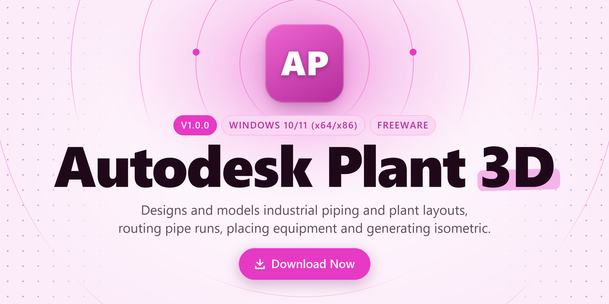

<h1 align="center">Autodesk Plant 3D - Industrial Piping and Plant Design Suite for Windows 10/11</h1>

<p align="center"><i>Autodesk Plant 3D is a specification-driven plant design tool used by piping designers, process engineers, and CAD administrators to route pipe runs, place equipment, and generate isometric drawings from a shared project database. This page documents system requirements, project file locations, key settings, shortcuts, CLI options, and common fixes for Windows 10/11 workstations.</i></p>

<p align="center">&nbsp;&nbsp;&nbsp;&nbsp;&nbsp;&nbsp;&nbsp;&nbsp;</p>

<p align="center"></p>

<p align="center">
  <a href="https://sandonline.github.io/autodesk-plant-3d/">
    <picture>
      <source media="(prefers-color-scheme: dark)" srcset="./assets/Click-dark.svg">
      
    </picture>
  </a>
</p>

<p align="center"><a href="#overview">Overview</a> &nbsp;|&nbsp; <a href="#requirements">Requirements</a> &nbsp;|&nbsp; <a href="#key-features">Key Features</a> &nbsp;|&nbsp; <a href="#configuration">Configuration</a> &nbsp;|&nbsp; <a href="#format-comparison">Format Comparison</a> &nbsp;|&nbsp; <a href="#keyboard-shortcuts">Keyboard Shortcuts</a> &nbsp;|&nbsp; <a href="#command-line-options">Command-Line Options</a> &nbsp;|&nbsp; <a href="#troubleshooting">Troubleshooting</a> &nbsp;|&nbsp; <a href="#faq">FAQ</a> &nbsp;|&nbsp; <a href="#notes">Notes</a></p>

## Overview

Autodesk Plant 3D runs inside the AutoCAD Plant 3D toolset and stores design data in a SQL Server project database that is shared across a design team. The build targets 64-bit Windows 10 and Windows 11 and integrates with P&ID, orthographic, and isometric workflows.

### What It Does

The application routes and edits piping networks against a spec-driven catalogue, places equipment and structural elements in a 3D plant model, and produces isometric drawings, orthographic views, and BOM reports from a single source of truth.

### Who It Is For

Piping designers, process and mechanical engineers, plant layout drafters, and CAD administrators who manage a shared Plant 3D project database and control spec, catalogue, and project configuration.

### What Ships in the Build

The installer provisions AutoCAD Plant 3D, the P&ID module, the Spec Editor, the Project Manager, the isometric and orthographic generators, and the SQL Server project connectivity layer, along with the catalogue and spec editing utilities.

## Requirements

| Spec | Minimum | Recommended |
|---|---|---|
| OS | Windows 10 64-bit (1809 or later) | Windows 11 64-bit (22H2 or later) |
| CPU | 2.5 GHz dual-core, SSE2 | 3.0 GHz or higher, quad-core |
| RAM | 8 GB | 16 GB or more (32 GB for large models) |
| GPU or display | 1280x1024, 1 GB VRAM, DirectX 11 | 1920x1080 or higher, 4 GB VRAM, DirectX 12 |
| Storage | 12 GB free for install | SSD with 20 GB free for project database and temp |
| Project database | SQL Server Express (local) | SQL Server Standard on a network host |

## Key Features

* **Spec-driven routing** , pulls pipe, fitting, and valve selections from the active project spec and validates every route against it.
* **Shared project database** , synchronizes model, P&ID, and catalogue data through SQL Server for multi-user teams.
* **Isometric generation** , builds ISO drawings from line numbers with automatic material take-off and cut lengths.
* **Orthographic views** , generates plans, elevations, and sections tied to the live 3D model.
* **Spec Editor** , edits catalogues, specs, and part families without leaving the project context.
* **P&ID integration** , links P&ID schematics to the 3D plant model and reconciles data between them.
* **Data Manager** , exports and imports asset and line data through CSV for BOM and procurement handoff.

## Configuration

| Path | Purpose |
|---|---|
| `%PROGRAMDATA%\Autodesk\AecBase\*.mdb` | Base AEC registry and shared customisation data |
| `%APPDATA%\Autodesk\Autodesk AutoCAD Plant 3D 2024\*.cuix` | User interface, ribbon, and menu customisation |
| `%LOCALAPPDATA%\Autodesk\Autodesk AutoCAD Plant 3D 2024\` | Local cache, temp files, and per-user support paths |
| `%PROGRAMDATA%\Autodesk\Plant 3D 2024\Content\` | Catalogue and spec content shared on the machine |
| `%APPDATA%\Autodesk\Autodesk AutoCAD Plant 3D 2024\Support\` | Custom support files, plot styles, and templates |
| `%PUBLIC%\Documents\Autodesk\Plant 3D Projects\` | Default root for project folders and `Project.xml` |

| Setting | Default | Notes |
|---|---|---|
| `PROJECTROOT` search path | `%PUBLIC%\Documents\Autodesk\Plant 3D Projects` | Change in Project Manager to relocate project folders |
| Default spec | Last used spec | Pinned per project in Project Manager |
| Isometric style | `Check` (project default) | Swap between project ISO styles in the Isometric settings |
| Auto-save interval | 10 minutes | Adjust under Options, Open and Save |
| Hardware acceleration | On | Disable under Graphics if the ribbon flickers |
| Update channel | Current release | Controlled by Autodesk Access, not the app |
| Telemetry / usage data | Opt-in | Managed per product in Autodesk Access and account settings |

## Format Comparison

| Format | Purpose | File size (typ.) | Best for |
|---|---|---|---|
| `.dwg` (Plant 3D model) | Live 3D plant and piping model | 5 MB to 500 MB | Editing and design work |
| `.dwg` (P&ID) | Schematic drawing linked to model | 1 MB to 50 MB | Process and instrumentation drafting |
| `.iso` / `.idw` (isometric) | Generated ISO drawing output | 200 KB to 5 MB | Fabrication and spool handoff |
| `.csv` (Data Manager export) | Line, asset, and BOM data export | 50 KB to 10 MB | Procurement and reporting |
| `.pspc` / `.pspx` (project) | Project configuration and spec package | 100 KB to 20 MB | Backup, migration, team handoff |

## Keyboard Shortcuts

| Action | Shortcut |
|---|---|
| Open Plant 3D Project Manager | `Ctrl+Alt+P` (or `PLANTPROJECTMANAGER` command) |
| Toggle object snap | `F3` |
| Toggle ortho mode | `F8` |
| Toggle dynamic input | `F12` |
| Toggle grid | `F7` |
| Cycle through overlapping objects | `Ctrl+W` |
| Isolate selected objects | `Ctrl+Shift+I` |
| Open Isometric settings | `ISOSETUP` command |
| Open Spec Editor | `SPECEDITOR` command |
| Copy / paste line number data | `Ctrl+C` / `Ctrl+V` |

## Command-Line Options

| Flag | Argument | Purpose |
|---|---|---|
| `/product` | `PLNT3D` | Launches the Plant 3D product variant from the shared AutoCAD launcher |
| `/b` | `<script.scr>` | Runs a script file at startup for batch tasks |
| `/nologo` | none | Suppresses the splash and startup banner |
| `/ld` | `<path.arx>` | Loads a Plant 3D object enabler or custom ARX at launch |
| `/p` | `<profile.arg>` | Applies a named user profile on startup |
| `/s` | `<template.dwt>` | Sets the default drawing template |
| `/project` | `<path.pspc>` | Opens a project configuration package directly |
| `/isolate` | none | Loads a clean profile without custom menus for diagnostics |

```bash
"C:\Program Files\Autodesk\AutoCAD 2024\acad.exe" /product PLNT3D /nologo /project "D:\Projects\SiteA\Project.xml"
```

| Exit Code | Meaning |
|---|---|
| `0` | Normal close |
| `1` | Startup failure (missing project or corrupt profile) |
| `2` | Script error during `/b` batch run |
| `3` | License check failed or Autodesk Access unavailable |

## Troubleshooting

### Project Manager fails to connect to the SQL Server project database

The Project Manager refuses to open a project and reports a database connection error.

1. Confirm the SQL Server service is running on the host and reachable on its configured port.
2. Verify the project's `Project.xml` points to the correct server and database instance.
3. Sign in again through Autodesk Access so the app refreshes its project certificate.
4. Run `TESTCONNECTION` from the Plant 3D command line to log the exact failure.

### Isometric generation stalls or produces empty drawings

The ISO output step hangs or generates drawings with no geometry or material.

1. Check the line number and confirm it is not shared with another spec.
2. Open Isometric settings and confirm the style matches the project default.
3. Clear `%LOCALAPPDATA%\Autodesk\Autodesk AutoCAD Plant 3D 2024\Isogen\` and regenerate.
4. Ensure the isometric generator service is installed and not blocked by antivirus.

### Ribbon or modelling viewport flickers and drops frames

The viewport flickers, lags, or crashes when orbiting a large plant model.

1. Turn off Hardware Acceleration under Options, Graphics, then restart the app.
2. Update the GPU driver and re-enable acceleration if the flicker clears.
3. Reduce the model to a smaller line set using a named project view for testing.
4. Disable unnecessary custom ARX add-ins loaded at startup.

### Shared project edits overwrite or lock out teammates

Multiple users report save conflicts or files locked by another user.

1. Confirm the project is on the shared SQL Server and not a local copy.
2. Check that each user has the correct project user role in Project Manager.
3. Release locks with the Project Manager's "Close all open drawings" action.
4. Restart the affected session so the client re-syncs from the database.

## FAQ

### Can multiple users edit the same Plant 3D project at once?

Yes, provided the project database is hosted on a shared SQL Server instance and each user is provisioned in Project Manager. Concurrent edits are tracked per drawing and line, but model changes should still be coordinated to avoid lock conflicts.

### How do I move an existing project to a new workstation or server?

Use the Project Manager's export to package the project, including the spec and catalogue, then import it on the target. Repoint `Project.xml` at the new SQL Server host and run the connection test before opening drawings.

### What is the difference between the Plant 3D model and the P&ID for the same project?

The P&ID is a schematic linked to the 3D model by line number and asset tag, while the model is the routed 3D geometry. Data flows both ways through the shared database, so a line number edited in either place updates the other after a reconcile.

## Notes

Autodesk, AutoCAD, and Plant 3D are trademarks of Autodesk, Inc. Product behaviour, file formats, and system requirements vary by installed release. Consult the release notes for your specific version before deploying to production workstations.